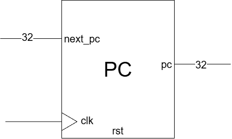
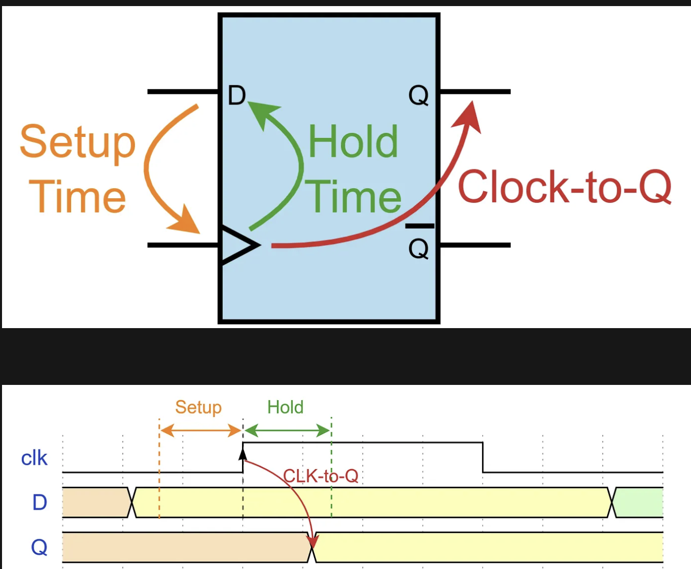

[English](README.md) | 繁體中文

# PC

PC（Program Counter，程式計數器）用來保存指令位址。這個模組是一個 32-bit 暫存器，在 clock 上升緣時，依照 `rst` 決定要清零，還是載入 `next_pc`。

- 電路圖



- Port Table

| 訊號 | 方向與寬度 | 功能 |
| --- | --- | --- |
| `clk` | 1-bit 輸入 | 時脈，在上升緣觸發更新 |
| `rst` | 1-bit 輸入 | 重置信號，為 1 時在上升緣將 PC 清零 |
| `next_pc` | 32-bit 輸入 | 準備在下一個上升緣載入的位址 |
| `pc` | 32-bit 輸出 | 目前儲存的指令位址 |

```verilog
module pc
(
    input wire clk,
    input wire rst,
    input wire [31:0] next_pc,
    output reg [31:0] pc
);
```

# Code

- 在上升緣更新 PC
    ```verilog
    always @(posedge clk) begin
        if (rst)
            pc <= 32'h0000_0000;
        else
            pc <= next_pc;
    end
    ```

- 更新範例

    | Clock 上升緣 | `rst` | `next_pc` | 更新後的 `pc` |
    | --- | --- | --- | --- |
    | 第 1 次 | 1 | `32'h0000_0100` | `32'h0000_0000` |
    | 第 2 次 | 0 | `32'h0000_0004` | `32'h0000_0004` |
    | 第 3 次 | 0 | `32'h0000_0008` | `32'h0000_0008` |


# 問題與討論

- 下一個位址由誰計算？

    這個模組只負責保存位址，**不會自行執行 `pc + 4`**。外部電路必須先計算下一個位址，再送入 `next_pc`。

    在目前使用 32-bit、4-byte 指令的情況下，循序執行通常會選擇 `pc + 4`；遇到 branch 或 jump 時，則可能選擇跳轉目標。這些位址選擇與計算邏輯不在目前的 `pc.v` 裡。

- Testbench 為什麼需要 `#1`？

    `tb_pc.v` 在 clock 上升緣後等待一段時間，再檢查 PC：

    ```verilog
    @(posedge clk);
    #1;
    check_pc(pc, expected_pc);
    ```

    **這裡的 `#1` 是讓 testbench 等待輸出更新後再檢查。實際電路也會遇到類似的「資料還沒準備好就取樣」問題：若資料未能在取樣 clock 邊緣之前滿足 setup time，就會發生 setup timing violation。**

    兩者可以用來類比，但原因不同：TB 這裡是尚未等到模擬器完成 NBA 更新；實際電路則是資料經過暫存器、組合邏輯與連線的傳播延遲後，來不及在取樣期限前穩定。`#1` 解決的是 TB 的觀察時機，實體電路則需要透過時脈週期與資料路徑設計來滿足 setup 要求。

    PC 使用 nonblocking assignment（`<=`）更新：

    ```verilog
    always @(posedge clk) begin
        if (rst)
            pc <= 32'h0000_0000;
        else
            pc <= next_pc;
    end
    ```

    clock 上升緣發生時，DUT 與 testbench 都會被喚醒。DUT 先計算右側的值，將 `pc` 的更新排到同一模擬時間的 NBA（Nonblocking Assignment）階段；testbench 若立即呼叫 `check_pc`，就會讀到更新前的 `pc`。

    ```text
    clock 上升緣
    → DUT 計算並排程 pc 的更新
    → TB 若立即檢查，會看到舊 pc
    → NBA 階段更新 pc
    → #1 結束後，TB 檢查新 pc
    ```


- Setup timing violation

    

    - 參考: https://medium.com/@aiclab.official/clock-to-q-modeling-why-non-blocking-assignments-matter-1b83c9e253b8
