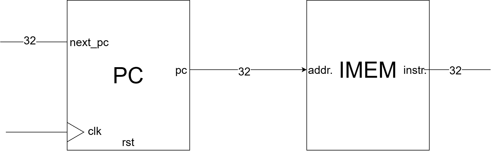

[English](README.md) | 繁體中文

# IMEM

指令記憶體（Instruction Memory）用來儲存程式指令。PC 透過 `addr` 提供以 byte 為單位的位址，IMEM 再透過 `instr` 輸出對應的指令。

這個模組沒有 clock，也沒有寫入介面。它採用組合邏輯讀取：位址改變後，輸出就會跟著更新，不需要等待 clock 邊緣。

- 電路圖



- Port Table

| 訊號 | 方向與寬度 | 功能 |
| --- | --- | --- |
| `addr` | 32-bit 輸入 | 來自 PC 的 byte 位址 |
| `instr` | 32-bit 輸出 | 位址對應的指令編碼 |

```verilog
module imem #(parameter DEPTH = 256) (
    input  wire [31:0] addr,
    output wire [31:0] instr
);
```

# Code

- 宣告指令記憶體

    ```verilog
    reg [31:0] mem [0:DEPTH-1];
    ```

    `DEPTH` 決定記憶體可以儲存幾筆指令，預設為 256。`mem` 每筆資料是 32 bits，也就是 4 bytes。

    ```text
    256 筆 × 4 bytes = 1024 bytes = 1 KiB（常稱 1 KB）
    ```

- 載入程式

    ```verilog
    initial $readmemh("program.hex", mem);
    ```

    模擬開始時，`$readmemh` 會讀取 `program.hex` 裡的十六進位資料，依序存入 `mem`。這裡使用相對路徑，因此會從執行模擬器時的工作目錄尋找檔案。

- 讀取指令

    ```verilog
    assign instr = mem[addr[31:2]];
    ```

    `addr[31:2]` 將 byte 位址轉成陣列索引。`assign` 是連續指定，會持續將選到的記憶體內容送到 `instr`。

- 讀取範例

    目前的 `program.hex` 包含以下四筆指令：

    | Byte 位址 `addr` | 陣列位置 | 指令輸出 `instr` | 指令內容 |
    | --- | --- | --- | --- |
    | `0x000` | `mem[0]` | `00500093` | `addi x1, x0, 5` |
    | `0x004` | `mem[1]` | `00A00113` | `addi x2, x0, 10` |
    | `0x008` | `mem[2]` | `002081B3` | `add x3, x1, x2` |
    | `0x00C` | `mem[3]` | `00000013` | `nop`（`addi x0, x0, 0`） |

# 問題與討論

- 為什麼位址除以 4 就能當作陣列索引？

    PC 的位址以 byte 為單位，但 `mem` 每筆資料占 4 bytes。因此，將 byte 位址除以 4，就能找到對應的陣列位置。

    `addr[31:2]` 會捨去最低兩個 bit。對這個無號位址來說，等同於整數除以 4：

    ```text
    addr = 0x000 → index = 0 → mem[0]
    addr = 0x004 → index = 1 → mem[1]
    addr = 0x008 → index = 2 → mem[2]
    addr = 0x00C → index = 3 → mem[3]
    ```

- 位址沒有對齊會怎樣？

    目前的程式假設每筆指令的位址都對齊 4 bytes，也就是 `addr[1:0]` 應為 `2'b00`。程式本身沒有檢查對齊：位址 0、1、2、3 都會讀取 `mem[0]`，因為最低兩位被忽略了。

- `addr` 有 32 bits，是否可以存取超過 1 KB 的資料？

    位址能表示的範圍，不等於實際記憶體容量。預設陣列只有 256 筆，有效索引為 0～255，對應的 byte 位址範圍是 `0x000`～`0x3FF`；最後一筆對齊指令的起始位址是 `0x3FC`。

    程式沒有檢查位址範圍。例如 `addr = 0x400` 會選到索引 256，超出有效範圍，在 RTL 模擬中會讀到 `x`（未知值）。