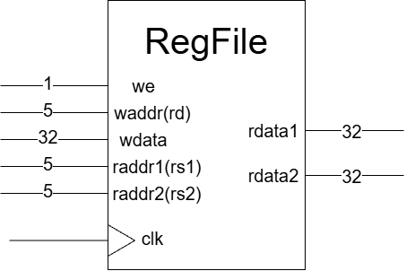

# Register File

暫存器檔案（Register File）用來保存 CPU 運算時使用的資料。這個模組包含 RV32I 的 32 個整數暫存器 `x0`～`x31`，每個暫存器都是 32 bits。

模組提供兩個讀取埠與一個寫入埠，可以同時讀取兩個暫存器，並在 clock 上升緣寫入一個暫存器。讀取使用組合邏輯，不需要等待 clock 邊緣。

- 電路圖



- Port Table

| 訊號 | 方向與寬度 | 功能 |
| --- | --- | --- |
| `clk` | 1-bit 輸入 | 時脈，在上升緣觸發寫入 |
| `we` | 1-bit 輸入 | Write enable，為 1 時允許寫入 |
| `waddr` | 5-bit 輸入 | 要寫入的暫存器編號，對應目的暫存器 `rd` |
| `wdata` | 32-bit 輸入 | 要寫入的資料 |
| `raddr1` | 5-bit 輸入 | 第一個讀取編號，對應來源暫存器 `rs1` |
| `raddr2` | 5-bit 輸入 | 第二個讀取編號，對應來源暫存器 `rs2` |
| `rdata1` | 32-bit 輸出 | 第一個讀取埠的資料 |
| `rdata2` | 32-bit 輸出 | 第二個讀取埠的資料 |

```verilog
module reg_file
(
    input wire clk,
    input wire we,
    input wire [4:0] waddr,
    input wire [31:0] wdata,
    input wire [4:0] raddr1,
    input wire [4:0] raddr2,
    output wire [31:0] rdata1,
    output wire [31:0] rdata2
);
```

## 各暫存器的常見用途

以下依照標準 ABI（Application Binary Interface）整理。ABI 名稱是暫存器的別名，例如 `ra` 就是 `x1`。除了 `x0` 固定為零，其餘用途主要由軟體遵守；目前的 register file 不會自動執行這些工作。

| 暫存器 | ABI 名稱 | 常見用途 | 函式呼叫時的保存責任 |
| --- | --- | --- | --- |
| `x0` | `zero` | 固定為零，寫入無效 | 固定為零 |
| `x1` | `ra` | 返回位址，讓函式知道要回到哪裡 | 呼叫者 |
| `x2` | `sp` | Stack pointer，指向目前的堆疊位置 | 被呼叫者須恢復 |
| `x3` | `gp` | Global pointer，協助存取全域資料 | 保留用途，函式不應任意修改 |
| `x4` | `tp` | Thread pointer，協助存取執行緒資料 | 保留用途，函式不應任意修改 |
| `x5` | `t0` | 暫存運算結果 | 呼叫者 |
| `x6` | `t1` | 暫存運算結果 | 呼叫者 |
| `x7` | `t2` | 暫存運算結果 | 呼叫者 |
| `x8` | `s0` / `fp` | 保存資料；需要 frame pointer 時使用它 | 被呼叫者 |
| `x9` | `s1` | 保存需跨函式呼叫保留的資料 | 被呼叫者 |
| `x10` | `a0` | 第 1 個參數，也用於回傳值 | 呼叫者 |
| `x11` | `a1` | 第 2 個參數，也用於回傳值 | 呼叫者 |
| `x12` | `a2` | 第 3 個參數 | 呼叫者 |
| `x13` | `a3` | 第 4 個參數 | 呼叫者 |
| `x14` | `a4` | 第 5 個參數 | 呼叫者 |
| `x15` | `a5` | 第 6 個參數 | 呼叫者 |
| `x16` | `a6` | 第 7 個參數 | 呼叫者 |
| `x17` | `a7` | 第 8 個參數 | 呼叫者 |
| `x18` | `s2` | 保存需跨函式呼叫保留的資料 | 被呼叫者 |
| `x19` | `s3` | 保存需跨函式呼叫保留的資料 | 被呼叫者 |
| `x20` | `s4` | 保存需跨函式呼叫保留的資料 | 被呼叫者 |
| `x21` | `s5` | 保存需跨函式呼叫保留的資料 | 被呼叫者 |
| `x22` | `s6` | 保存需跨函式呼叫保留的資料 | 被呼叫者 |
| `x23` | `s7` | 保存需跨函式呼叫保留的資料 | 被呼叫者 |
| `x24` | `s8` | 保存需跨函式呼叫保留的資料 | 被呼叫者 |
| `x25` | `s9` | 保存需跨函式呼叫保留的資料 | 被呼叫者 |
| `x26` | `s10` | 保存需跨函式呼叫保留的資料 | 被呼叫者 |
| `x27` | `s11` | 保存需跨函式呼叫保留的資料 | 被呼叫者 |
| `x28` | `t3` | 暫存運算結果 | 呼叫者 |
| `x29` | `t4` | 暫存運算結果 | 呼叫者 |
| `x30` | `t5` | 暫存運算結果 | 呼叫者 |
| `x31` | `t6` | 暫存運算結果 | 呼叫者 |

「呼叫者」表示呼叫函式前，若之後還需要原值，就要自行保存；被呼叫的函式可以改寫它。「被呼叫者」表示函式若使用這個暫存器，必須在返回前恢復原值。保存與恢復通常由軟體透過堆疊完成，register file 不會自動備份。

參數的實際分配會依資料型別與大小而定；表中的第 1～8 個參數是簡化理解。`fp` 是可選的 frame pointer，用來定位目前函式的堆疊框架。PC 則是另外的暫存器，不在 `x0`～`x31` 裡。

參考：[RISC-V ABI 暫存器使用慣例](https://docs.riscv.org/reference/abi/v1.0/riscv-cc-register-convention.html)。

# Code

- 宣告暫存器陣列

    ```verilog
    reg [31:0] registers [0:31];
    ```

    `[31:0]` 表示每筆資料有 32 bits，`[0:31]` 表示共有 32 筆，索引直接對應暫存器編號。

    ```text
    32 筆 × 32 bits = 1024 bits = 128 bytes
    ```

    這是程式宣告的陣列容量；`x0` 固定讀出零，合成工具可能省略不需要的儲存電路。

- 初始化暫存器

    ```verilog
    initial begin
        for (integer i = 0; i < 32; i = i + 1) begin
            registers[i] <= 32'h0000_0000;
        end
    end
    ```

    模擬開始時，將所有暫存器初始化為零。迴圈沒有時間控制，不會花 32 個 clock；這些 nonblocking assignment 會在起始模擬時間的 NBA 階段更新。

- 在上升緣寫入資料

    ```verilog
    always @(posedge clk) begin
        if (we && waddr != 5'h0) begin
            registers[waddr] <= wdata;
        end
    end
    ```

    每次 clock 上升緣，若 `we = 1` 且目的暫存器不是 `x0`，就將 `wdata` 寫入 `registers[waddr]`。否則保留原本的資料。

    `<=` 是 nonblocking assignment，會在上升緣取樣右側資料，再於同一模擬時間的 NBA 階段更新暫存器。

- 讀取兩個暫存器

    ```verilog
    assign rdata1 = raddr1 == 5'h0 ? 32'h0000_0000 : registers[raddr1];
    assign rdata2 = raddr2 == 5'h0 ? 32'h0000_0000 : registers[raddr2];
    ```

    `條件 ? A : B` 表示條件成立時選 A，否則選 B。讀取編號為 0 時直接輸出零，其他編號則輸出陣列中的資料。

    兩個讀取埠各自選擇資料，可以讀不同的暫存器，也可以同時讀取同一個暫存器。讀取位址或對應資料改變後，輸出會跟著更新。

- 讀寫範例

    目前 `tb_reg_file.v` 的測試包含：

    | 操作 | 條件 | 預期結果 |
    | --- | --- | --- |
    | 寫入 `x1` | 上升緣時 `we = 1`、`waddr = 5'h1`、`wdata = 32'h0000_0001` | `x1` 更新為 1 |
    | 寫入 `x31` | 上升緣時 `we = 1`、`waddr = 5'h1F`、`wdata = 32'h0000_0020` | `x31` 更新為十進位 32 |
    | 同時讀取 | `raddr1 = 5'h1`、`raddr2 = 5'h1F` | 輸出分別為 1 與 32 |
    | 嘗試寫入 `x0` | 上升緣時 `we = 1`、`waddr = 0`、`wdata = 32'hFFFF_FFFF` | 寫入被忽略，讀取 `x0` 仍為零 |

# 問題與討論

- 為什麼暫存器位址只需要 5 bits？

    5 bits 可以表示 0～31，共 32 個編號，剛好能選擇 `x0`～`x31`。這裡的位址是暫存器編號，不是 byte 位址，因此不需要像 IMEM 一樣除以 4。

- 為什麼不能寫入 `x0`？

    RV32I 規定 `x0` 讀取時永遠是零。程式一方面阻止對 `x0` 寫入，另一方面在讀取編號為 0 時直接輸出零，因此不依賴 `registers[0]` 的儲存值。

- 為什麼沒有 `rst`？`initial` 和 reset 一樣嗎？

    目前模組沒有 reset 介面，只在模擬開始時透過 `initial` 清零一次，不能在執行途中重新觸發清零。RV32I 不要求一般整數暫存器 `x1`～`x31` 在 reset 後全部為零；是否清零是實作選擇，`x0` 則必須始終讀出零。

    `initial` 能否轉成硬體初始化功能，取決於合成工具與目標裝置，不能直接把模擬中的初始值當成所有實體硬體都能保證的行為。

- 同時讀寫同一個暫存器會怎樣？

    對非 `x0` 的暫存器，在寫入上升緣之前，讀取埠輸出原本的資料。上升緣發生後，等 NBA 寫入及組合邏輯更新完成，讀取埠才輸出新資料。因此，在上升緣當下立刻檢查，仍可能看到舊值。
