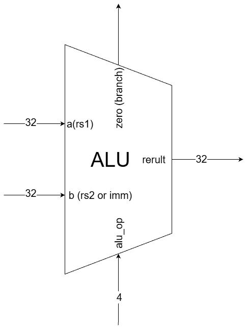

English | [繁體中文](README.zh-TW.md)

# ALU

The ALU (Arithmetic Logic Unit) performs arithmetic, bitwise logic, comparisons, and shifts on two 32-bit inputs. `alu_op` selects the operation. `result` holds the 32-bit output, and `zero` indicates whether the result is zero.

This is a combinational module with no clock or reset. Its outputs update when its inputs change.

- Circuit diagram



- Port Table

| Signal | Direction and width | Purpose |
| --- | --- | --- |
| `a` | 32-bit input | First operand |
| `b` | 32-bit input | Second operand; its lowest 5 bits select the shift amount |
| `alu_op` | 4-bit input | Selects one of ten operations |
| `result` | 32-bit output | Operation result |
| `zero` | 1-bit output | 1 when `result` is zero; otherwise 0 |

```verilog
module alu
(
    input wire [31:0] a,
    input wire [31:0] b,
    input wire [3:0] alu_op,
    output reg [31:0] result,
    output reg zero
);
```

## Operations

| alu_op | Operation | Result | Used by |
| :----- | :-------- | :----- | :------ |
| `4'b0000` | ADD — Add | a + b | ADD, ADDI; load/store address calculation |
| `4'b0001` | SUB — Subtract | a - b | SUB; BEQ/BNE comparison |
| `4'b0010` | AND — Bitwise AND | a & b | AND, ANDI |
| `4'b0011` | OR — Bitwise OR | a &#124; b | OR, ORI |
| `4'b0100` | XOR — Bitwise Exclusive OR | a ^ b | XOR, XORI |
| `4'b0101` | SLT — Set Less Than (Signed) | signed(a) < signed(b) ? 1 : 0 | SLT, SLTI |
| `4'b0110` | SLTU — Set Less Than Unsigned | unsigned(a) < unsigned(b) ? 1 : 0 | SLTU, SLTIU |
| `4'b0111` | SLL — Shift Left Logical | a << b[4:0] | SLL, SLLI |
| `4'b1000` | SRL — Shift Right Logical | a >> b[4:0] (fill with 0) | SRL, SRLI |
| `4'b1001` | SRA — Shift Right Arithmetic | signed(a) >>> b[4:0] (fill with sign bit) | SRA, SRAI |


# Code

- Shift amount for left and right shifts

    ```verilog
    wire [4:0] shamt = b[4:0];
    ```

- Calculate the result

    ```verilog
    always @(*) begin
        case (alu_op)
            // Ten operation cases; see the table above.
            default: result = 32'd0;
        endcase
        zero = (result == 32'h0000_0000) ? 1'b1 : 1'b0;
    end
    ```

- Test examples

    | Test case | Operation | `alu_op` | `a` | `b` | Expected `result` | `zero` |
    | --- | --- | --- | --- | --- | --- | --- |
    | 1 | ADD | `4'b0000` | `0x00000001` | `0x00000002` | `0x00000003` | 0 |
    | 2 | SUB | `4'b0001` | `0x00000003` | `0x00000002` | `0x00000001` | 0 |
    | 3 | AND | `4'b0010` | `0x00000003` | `0x00000002` | `0x00000002` | 0 |
    | 4 | OR | `4'b0011` | `0x00000003` | `0x00000002` | `0x00000003` | 0 |
    | 5 | XOR | `4'b0100` | `0x00000003` | `0x00000002` | `0x00000001` | 0 |
    | 6 | SLT | `4'b0101` | `0x00000001` | `0x00000002` | `0x00000001` | 0 |
    | 7 | SLTU | `4'b0110` | `0x00000001` | `0x00000002` | `0x00000001` | 0 |
    | 8 | SLL | `4'b0111` | `0x00000001` | `0x00000002` | `0x00000004` | 0 |
    | 9 | SRL | `4'b1000` | `0x00000004` | `0x00000002` | `0x00000001` | 0 |
    | 10 | SRA | `4'b1001` | `0xFFFFFFFC` | `0x00000002` | `0xFFFFFFFF` | 0 |
    | 11 | SUB (zero flag check) | `4'b0001` | `0x00000001` | `0x00000001` | `0x00000000` | 1 |

    All 11 tests are listed in the same order as `tb_alu.v`: one for each of the ten operations, plus a subtraction of equal values to check the zero flag.

# Questions and Discussion

- What is the difference between SLT and SLTU?

    With `a = 0xFFFFFFFF` and `b = 1`, SLT compares -1 with 1 and returns 1. SLTU compares 4294967295 with 1 and returns 0. Both return a full 32-bit value of either 0 or 1.

- What is the difference between SRL and SRA?

    Both shift bits to the right. The difference is how they fill the vacated upper bits:

    | Operation | Full name | Upper-bit fill | Common use |
    | --- | --- | --- | --- |
    | SRL | Shift Right Logical | Always 0 | Unsigned shifts and bit manipulation |
    | SRA | Shift Right Arithmetic | Original sign bit, `a[31]` | Signed shifts that preserve the sign |

    For example, shift `a = 32'hFFFF_FFFC` (signed -4) right by 2:

    ```text
    Input: 11111111 11111111 11111111 11111100
    SRL:   00111111 11111111 11111111 11111111 → 0x3FFFFFFF
    SRA:   11111111 11111111 11111111 11111111 → 0xFFFFFFFF (-1)
    ```

    Nonnegative values have a sign bit of 0, so both operations produce the same result. Negative values have a sign bit of 1: SRA fills with 1 to preserve the negative sign, while SRL fills with 0.

    The current implementation uses:

    ```verilog
    // SRL: a is unsigned, so the upper bits are filled with 0
    result = a >> shamt;
    // SRA: treat a as signed before the arithmetic right shift
    result = $signed(a) >>> shamt;
    ```

    `$signed(a)` matters: using `>>>` with an unsigned left operand does not provide the expected sign extension. Both operations use only `b[4:0]` as the shift amount.

    SRA acts like signed division by a power of two, rounded toward negative infinity. For example, shifting -3 right by 1 gives -2, while signed division that truncates toward zero gives -1.

- What happens on arithmetic overflow?

    The output keeps the lowest 32 bits. For example, `0xFFFFFFFF + 1` becomes zero. This module does not output a carry or overflow flag.

- Does `zero` mean the inputs are equal?

    It only means the selected operation produced zero. For SUB, a zero result indicates equal operands. Other operations can produce zero for different reasons, so branch control must also consider the selected operation and instruction.
