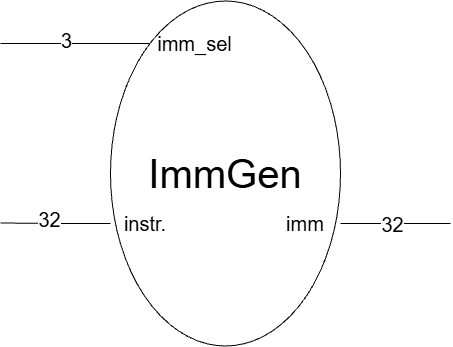

English | [繁體中文](README.zh-TW.md)

# Immediate Generator (ImmGen)

The immediate generator extracts and reconstructs a 32-bit immediate from an RV32I instruction. The control unit selects the format through `imm_sel`. This is combinational logic with no clock or reset; changing either input updates `imm`.

- Circuit diagram



- Port Table

| Signal | Direction and width | Purpose |
| --- | --- | --- |
| `instr` | 32-bit input | Full instruction word |
| `imm_sel` | 3-bit input | Immediate format selected by the control unit |
| `imm` | 32-bit output | Reconstructed immediate or offset |

```verilog
module immgen (
    input  wire [31:0] instr,
    input  wire [2:0]  imm_sel,
    output reg  [31:0] imm
);
```

- Formats

| `imm_sel` | Type | Immediate bits before sign extension | Example instructions | Value range / layout |
| --- | --- | --- | --- | --- |
| `3'b000` | I (Immediate) | `instr[31:20]` | ADDI, LW, JALR | -2048 to 2047 |
| `3'b001` | S (Store) | `{instr[31:25], instr[11:7]}` | SB, SH, SW | -2048 to 2047 |
| `3'b010` | B (Branch) | `{instr[31], instr[7], instr[30:25], instr[11:8], 1'b0}` | BEQ, BNE, BLT | -4096 to 4094 bytes, in steps of 2 |
| `3'b011` | U (Upper Immediate) | `{instr[31:12], 12'b0}` | LUI, AUIPC | Upper 20 bits from the instruction; lower 12 bits zero |
| `3'b100` | J (Jump) | `{instr[31], instr[19:12], instr[20], instr[30:21], 1'b0}` | JAL | -1,048,576 to 1,048,574 bytes, in steps of 2 |

I/S/B/J immediates are sign-extended using `instr[31]`. U-type already produces a full 32-bit value by appending 12 zero bits. Selectors `101`, `110`, and `111` return zero. R-type has no immediate and does not need a dedicated selection.

B/J outputs already contain the implicit low zero bit: do not shift them again. The CPU adds these offsets to the current instruction's PC. For load/store and JALR, the CPU adds the I/S immediate to `rs1`; JALR also clears target bit 0. ImmGen only produces the immediate and does not calculate addresses or check target alignment.

# Code

- Reconstruct the immediate

    ```verilog
    always @(*) begin
        case (imm_sel)
            3'b000: imm = {{20{instr[31]}}, instr[31:20]};           // I
            3'b001: imm = {{20{instr[31]}}, instr[31:25], instr[11:7]}; // S
            3'b010: imm = {{19{instr[31]}}, instr[31], instr[7],     // B
                           instr[30:25], instr[11:8], 1'b0};
            3'b011: imm = {instr[31:12], 12'b0};                     // U
            3'b100: imm = {{11{instr[31]}}, instr[31], instr[19:12], // J
                           instr[20], instr[30:21], 1'b0};
            default: imm = 32'd0;
        endcase
    end
    ```

    Concatenation (`{...}`) rearranges the instruction fields, and replication (for example, `{20{instr[31]}}`) fills the upper bits with the sign bit. The `default` assignment defines the output for unused selectors and prevents a latch.

- Test examples

    `tb_immgen.v` runs 16 self-checking cases. Each case applies inputs, waits 1 ns for combinational updates, and compares the result using `!==`, so unknown outputs also fail.

    | Coverage | Cases |
    | --- | --- |
    | I | 0, 10, -2048: zero, positive value, and sign extension |
    | S | 12, -2048: split immediate fields and sign extension |
    | B | 8, 2048, -4096: low zero bit, relocated bit 11, and sign extension |
    | U | `0x12345000`, `0x80000000`: lower 12 bits cleared and top bit preserved |
    | J | 16, 2048, -1,048,576: low zero bit, relocated bit 11, and sign extension |
    | Unused selectors | `101`, `110`, `111` return zero for an all-ones instruction |

    Expected results are literal constants. Unrelated instruction fields are set to one to check that they do not affect the immediate. A failure reports the inputs, actual output, and expected output; `$fatal(1, ...)` makes `make sim` fail. A successful run prints `All 16 tests passed!`.

# Questions and Discussion

- Why does `imm_sel` come from the control unit?

    This module does not decode `opcode` or validate instruction encodings. The control unit must select the appropriate format.

- Why is the B/J immediate split into several fields?

    Their encodings distribute offset bits across the instruction. ImmGen restores their numerical order and appends the implicit low zero bit. See the [ISA format comparison](../00_isa/README.md).

- Do immediate shifts use the entire I-type output as a shift amount?

    No. RV32I immediate shifts use the low 5 bits as `shamt`; upper instruction bits distinguish the operation. The ALU/control logic must handle that distinction.
