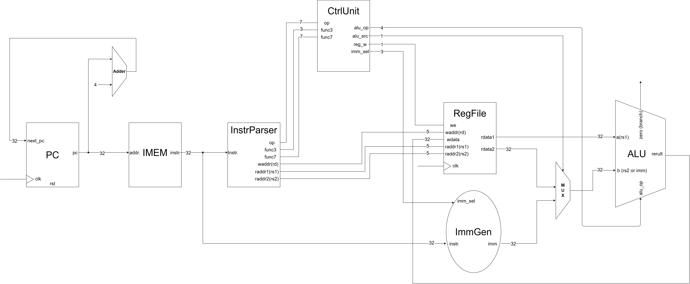

[English](README.md) | 繁體中文

# R/I Datapath

本章的重點是新增的 Control Unit（控制單元）、PC adder（PC 加法器）與 instruction parser（指令欄位擷取）。它們將前面章節的 PC、IMEM、Register File、ImmGen 與 ALU 串接成支援 R-type 與 I-type ALU 指令的單週期資料路徑。

PC adder 產生下一個循序位址，parser 將指令拆成欄位，Control Unit便拿這些資訊決策ALU要運算什麼內容以及RegFile, ImmGen如何配合ALU。PC 與RefFile在上升緣更新，其餘路徑使用組合邏輯。

- 電路圖




## 新增邏輯與資料流

| 新增部分 | 所在位置 | 功能 |
| --- | --- | --- |
| PC adder | `core_ri.v` 的 `assign next_pc` | 以組合邏輯計算 `pc + 4` |
| Instruction parser | `core_ri.v` 的 Decode 區段 | 擷取指令欄位並送往控制單元與暫存器檔案 |
| Control Unit | `control.v`，instance 為 `ctrl` | 解碼 R/I ALU 指令，產生資料路徑控制訊號 |
| ALUSrc MUX | `core_ri.v` 的 `wire [31:0] alu_b = alu_src ? imm : rdata2` | 依 `alu_src` 選擇 ALU 第二運算元：0 選暫存器資料 `rdata2`（R-type）；1 選立即數 `imm`（I-type ALU） |


## Control Unit（控制單元）

`control.v` 是組合邏輯解碼器，沒有 clock 或內部狀態。它先以 `opcode` 分辨 R-type 與 I-type ALU，再由func3, func7選擇運算。Parser 只擷取位元，真正決定「執行什麼」的是控制單元。

| 訊號 | 方向與寬度 | 用途 |
| --- | --- | --- |
| `opcode` | 7-bit 輸入 | 選擇主要指令類別 |
| `funct3` | 3-bit 輸入 | 選擇算術、邏輯、比較或位移操作 |
| `funct7` | 7-bit 輸入 | 目前使用 bit 5 區分 ADD/SUB、SRL/SRA |
| `reg_write` | 1-bit 輸出 | 接至 Register File 的 `we` |
| `alu_src` | 1-bit 輸出 | 0 選 `rdata2`；1 選 `imm` 作為 ALU 第二運算元 |
| `alu_op` | 4-bit 輸出 | 選擇 ALU 操作；這是內部控制編碼，不是 opcode |
| `imm_sel` | 3-bit 輸出 | 選擇 ImmGen 格式；此資料路徑使用 `000`（I-type） |

```verilog
control ctrl (
    .opcode(opcode), .funct3(funct3), .funct7(funct7),
    .reg_write(reg_write), .alu_src(alu_src),
    .alu_op(alu_op), .imm_sel(imm_sel)
);
```

### 指令類別與控制輸出

| 指令類別 | `opcode` | `reg_write` | `alu_src` | `imm_sel` | ALU 第二運算元 |
| --- | --- | --- | --- | --- | --- |
| R-type ALU | `0110011` | 1 | 0 | `x`（未使用） | `rdata2` |
| I-type ALU | `0010011` | 1 | 1 | `000`（I-type） | `imm` |

| 操作 | `alu_op` |
| --- | --- |
| ADD / ADDI | `0000` |
| SUB | `0001` |
| AND / ANDI | `0010` |
| OR / ORI | `0011` |
| XOR / XORI | `0100` |
| SLT / SLTI | `0101` |
| SLTU / SLTIU | `0110` |
| SLL / SLLI | `0111` |
| SRL / SRLI | `1000` |
| SRA / SRAI | `1001` |

控制單元以 `{funct7[5], funct3}` 區分 R-type 操作；I-type 使用 `funct3`，立即數右移另用 `funct7[5]` 區分邏輯／算術右移。位移量取 ALU 第二運算元的最低 5 bits。可參考 [ISA 格式](../00_isa/README.zh-TW.md) 與 [ALU](../04_alu/README.zh-TW.md)。

這是部分資料路徑，尚未實作 load、store、branch、jump、LUI 與 AUIPC。

### 解碼範例與預設值

- `add x3, x1, x2`：opcode 為 `0110011`，選擇 `rdata2`，`alu_op = 0000`，並啟用寫回。
- `sub x4, x1, x2`：同為 R-type，但 `funct7[5] = 1`、`funct3 = 000`，因此 `alu_op = 0001`。
- `addi x1, x0, 5`：opcode 為 `0010011`，選擇 I-type 立即數 5，`alu_op = 0000`，並啟用寫回。

`always @(*)` 一開始先設定 `reg_write = 0`、`alu_src = 0`、`alu_op = 0000`、`imm_sel = 000`，再依指令覆寫，讓每條路徑都有輸出，避免 latch。未知 opcode 保持不寫回；這不等於完整的非法指令檢查。

## PC Adder（PC 加法器）

```verilog
wire [31:0] pc, next_pc, instr;
assign next_pc = pc + 32'd4;
pc pc_reg (.clk(clk), .rst(rst), .next_pc(next_pc), .pc(pc));
```

每條純 RV32I 指令為 32 bits，也就是 4 bytes，因此 byte 位址依 `0 → 4 → 8 → 12` 前進。Adder 持續計算 `next_pc`，不需等待 clock；`pc_reg` 才是在上升緣保存新值的狀態元件。`rst = 1` 時，PC 在上升緣改為 0。

這個加法器與執行指令的 ALU 是不同的組合邏輯，能同時計算下一個位址與指令結果。目前沒有 branch/jump 的 PC 選擇器，因此非 reset 時固定採用 `pc + 4`。IMEM 以 `pc[31:2]` 將 byte 位址轉為 word 索引。

## Instruction Parser（指令欄位擷取）

```verilog
wire [6:0] opcode = instr[6:0];
wire [4:0] rd     = instr[11:7];
wire [2:0] funct3 = instr[14:12];
wire [4:0] rs1    = instr[19:15];
wire [4:0] rs2    = instr[24:20];
wire [6:0] funct7 = instr[31:25];
```

這些是 `core_ri.v` 內的 wire 與連續連接，不是獨立 module，也不需 clock。`wire ... = ...` 在這裡代表訊號持續跟隨指令欄位，不是只在模擬開始時取一次值。

| 欄位 | 指令位元 | 送往哪裡 |
| --- | --- | --- |
| `opcode` | `[6:0]` | Control Unit：指令類別 |
| `rd` | `[11:7]` | Register File `waddr`：寫回目的 |
| `funct3` | `[14:12]` | Control Unit：操作種類 |
| `rs1` | `[19:15]` | Register File `raddr1`：第一個來源 |
| `rs2` | `[24:20]` | Register File `raddr2`：第二個來源 |
| `funct7` | `[31:25]` | Control Unit：進一步區分操作 |

I-type 的 `[24:20]` 實際屬於立即數；parser 仍會把這段接到 `rs2`，但控制單元用 `alu_src = 1` 選取 `imm`，因此第二個讀取埠不參與 ALU 運算。同樣地，I-type 的高位通常是立即數，只有位移指令使用其中的操作編碼位元。完整 `instr` 另外送進 ImmGen，立即數重組不由 parser 負責。

# Code

- 選擇下一個 PC、ALU 運算元與寫回資料

    ```verilog
    assign next_pc = pc + 32'd4;
    wire [31:0] alu_b = alu_src ? imm : rdata2;
    assign wb_data = alu_result;
    ```

    一個執行週期內，目前 PC 選出指令，暫存器提供運算元，ALU 計算結果。到下一個上升緣，結果寫入 `rd`，PC 同時前進。非阻塞賦值（`<=`）在正緣之後更新狀態，組合邏輯隨後反應，波形才會穩定。

- 測試程式

    `program.hex` 包含以下八個指令字。IMEM 使用 `pc[31:2]` 作為 word 索引，因此指令位址每次增加 4 bytes。

    | PC | 機器碼 | 指令 | 預期結果 |
    | --- | --- | --- | --- |
    | 0x00 | `00500093` | `addi x1, x0, 5` | `x1 = 5` |
    | 0x04 | `00A00113` | `addi x2, x0, 10` | `x2 = 10` |
    | 0x08 | `002081B3` | `add x3, x1, x2` | `x3 = 15` |
    | 0x0C | `40208233` | `sub x4, x1, x2` | `x4 = 0xFFFFFFFB` (-5) |
    | 0x10 | `0020F2B3` | `and x5, x1, x2` | `x5 = 0` |
    | 0x14 | `0020E333` | `or x6, x1, x2` | `x6 = 15` |
    | 0x18 | `00000013` | `addi x0, x0, 0` (NOP) | `x0 = 0` |
    | 0x1C | `00000013` | `addi x0, x0, 0` (NOP) | `x0 = 0` |

- 測試範例

    `tb_core_ri.v` 產生週期 10 ns 的 clock，施加 reset 後等待八次上升緣，再等 1 ns，透過 `dut.rf.registers[...]` 檢查 `x1`～`x6`。額外的延遲讓暫存器寫入完成。共六項結果檢查，涵蓋 ADDI、ADD、SUB、AND、OR；此程式未測試其他支援的 ALU 指令。


# 問題與討論

- 暫無
