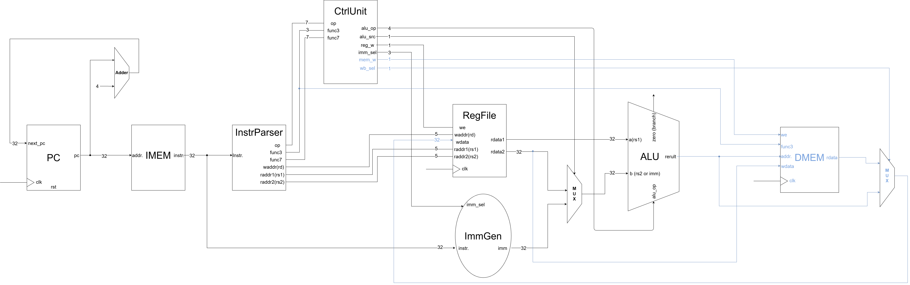

English | [繁體中文](README.zh-TW.md)

# R/I/S Datapath

This chapter extends the [R/I datapath](../06_ri_datapath/README.md) with data memory access. It focuses on DMEM, the new load/store controls in the Control Unit, and the Write-back MUX. The ALU now calculates memory addresses as well as arithmetic results.

The R/I/S name follows the directory naming: stores use S-type, while loads are still I-type. The PC adder, instruction parser, and ALUSrc MUX carry over from the previous chapter. PC still advances by 4 outside reset; branches/jumps, LUI, and AUIPC are not implemented.

- Circuit diagram (new components shown in blue)



## New Logic and Data Flow

| New component | Location | Purpose |
| --- | --- | --- |
| DMEM | `dmem.v`, instance `dmem0` | Synchronous writes and asynchronous reads of bytes, halfwords, and words |
| Control Unit extensions | `S` and `L` cases in `control.v` | Add `mem_write` and `wb_sel`, select address calculation and immediate format |
| Write-back MUX | `assign wb_data` in `core_ris.v` | Selects the ALU result or DMEM read data for the Register File |

## DMEM (Data Memory)

DMEM is separate from the instruction memory, IMEM. `DEPTH` defaults to 256, but storage consists of `DEPTH × 4` 8-bit entries: 1024 bytes (1 KiB), at byte addresses 0–1023. `addr` directly indexes bytes, unlike IMEM's use of `addr[31:2]`.

- Port Table

| Signal | Direction and width | Purpose |
| --- | --- | --- |
| `clk` | 1-bit input | Triggers writes on the rising edge |
| `we` | 1-bit input | Connected to `mem_write`; enables stores when high |
| `addr` | 32-bit input | Byte address from `alu_result` |
| `wdata` | 32-bit input | Data from `rdata2`, the value in `rs2` |
| `funct3` | 3-bit input | Selects access width and load extension |
| `rdata` | 32-bit output | Combinational read result, connected to `mem_rdata` |

```verilog
wire [31:0] mem_rdata;
dmem dmem0 (
    .clk(clk), .we(mem_write),
    .addr(alu_result), .wdata(rdata2),
    .funct3(funct3), .rdata(mem_rdata)
);
```

### Access Width and Extension

| `funct3` | Load | Read result | Store | Write data |
| --- | --- | --- | --- | --- |
| `000` | LB | Sign-extend 8 bits to 32 bits | SB | `wdata[7:0]` |
| `001` | LH | Sign-extend 16 bits to 32 bits | SH | `wdata[15:0]` |
| `010` | LW | Full 32 bits | SW | `wdata[31:0]` |
| `100` | LBU | Zero-extend 8 bits to 32 bits | — | No write |
| `101` | LHU | Zero-extend 16 bits to 32 bits | — | No write |

Storage is little-endian: the least significant byte occupies the lowest address. Reads have no read-enable and update when the address, `funct3`, or relevant contents change. Stores modify memory only at a rising edge with `we = 1`. Other `funct3` values return zero on reads and perform no write.

DMEM has no reset or initialization; unwritten locations are `X` in simulation. There are no address-range or alignment checks or exception handling. Every byte of a multibyte access must lie within the valid range.

## Control Unit Extensions

The new opcodes are `S = 0100011` and `L = 0000011`. Both select ALU ADD to calculate `rs1 + offset`. Stores use S-type immediates; loads use I-type immediates.

| New signal | Width | Purpose |
| --- | --- | --- |
| `mem_write` | 1 bit | Enables DMEM writes for stores; zero otherwise |
| `wb_sel` | 1 bit | 0 selects the ALU result; 1 selects memory data |

| Instruction class | `opcode` | `reg_write` | `alu_src` | `imm_sel` | `alu_op` | `mem_write` | `wb_sel` |
| --- | --- | --- | --- | --- | --- | --- | --- |
| R-type ALU | `0110011` | 1 | 0 | — | By operation | 0 | 0 |
| I-type ALU | `0010011` | 1 | 1 | `000` | By operation | 0 | 0 |
| Store | `0100011` | 0 | 1 | `001` (S) | `0000` | 1 | 0 |
| Load | `0000011` | 1 | 1 | `000` (I) | `0000` | 0 | 1 |

R-type does not use an immediate: `—` means the value does not affect the result, while the implementation still defaults to `000`. Stores do not write registers, so their `wb_sel` does not affect the result. `funct3` feeds DMEM directly to select access width; SB/SH/SW do not need different `alu_op` values.

```verilog
// Store (opcode 0100011)
S: begin
    alu_src = 1;
    reg_write = 0;
    imm_sel = 3'b001;
    mem_write = 1;
    wb_sel = 1'b0;
    alu_op = 4'b0000;
end
// Load (opcode 0000011)
L: begin
    alu_src = 1;
    reg_write = 1;
    imm_sel = 3'b000;
    mem_write = 0;
    wb_sel = 1'b1;
    alu_op = 4'b0000;
end
```

## Write-back MUX

```verilog
assign wb_data = wb_sel ? mem_rdata : alu_result;
```

| `wb_sel` | Selected data | Use |
| --- | --- | --- |
| 0 | `alu_result` | R/I ALU instruction results |
| 1 | `mem_rdata` | Data read from DMEM by a load |

`wb_sel` only selects the data source; `reg_write` determines whether a register is written. A store uses the ALU result as its address and `rdata2` as its data, with `reg_write = 0`, so the address is not written into a register. The ALUSrc MUX selects an ALU input; the Write-back MUX selects the output sent to the Register File.

# Code

- DMEM byte ordering for SW/LW

    ```verilog
    reg [7:0] mem [0:(DEPTH*4)-1];

    // SW, inside always @(posedge clk), when we and funct3 == 3'b010
    mem[addr]   <= wdata[7:0];
    mem[addr+1] <= wdata[15:8];
    mem[addr+2] <= wdata[23:16];
    mem[addr+3] <= wdata[31:24];

    // LW, inside always @(*), when funct3 == 3'b010
    rdata = {mem[addr+3], mem[addr+2], mem[addr+1], mem[addr]};
    ```

- Store/Load execution

    `sw x1, 0(x0)`: adds the S-type immediate 0 to `x0`, producing address 0. At the rising edge, DMEM stores `x1` across addresses 0–3; the Register File is not written.

    `lw x2, 0(x0)`: uses the I-type immediate 0 to calculate the same address. DMEM reads combinationally, and the Write-back MUX selects `mem_rdata` for writing to `x2` at the next rising edge. Thus, in this single-cycle model, an LW immediately following an SW can read the newly stored data.

- Test examples

    The current `program.hex` executes eight R/I instructions (including two NOPs), then the four words below. `tb_core_ris.v` waits eight rising edges plus 1 ns and checks `x1`–`x6` against 5, 10, 15, -5, 0, and 15. After another three rising edges plus 1 ns, it checks that `x1` and `x2` are both 42. These are eight register-result checks; byte/halfword accesses and signed/unsigned load differences are not tested yet.

    | PC | Machine code | Instruction | Expected result |
    | --- | --- | --- | --- |
    | 0x20 | `02A00093` | `addi x1, x0, 42` | `x1 = 42` |
    | 0x24 | `00102023` | `sw x1, 0(x0)` | `mem[0:3]` contains `2A 00 00 00` in order |
    | 0x28 | `00002103` | `lw x2, 0(x0)` | `x2 = 42` |
    | 0x2C | `00000013` | `nop` | No change to general registers |

# Questions and Discussion

- None yet.
