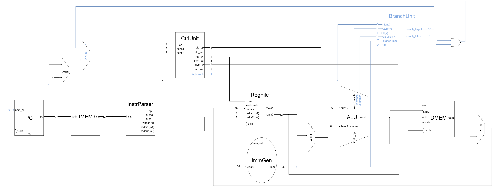

English | [繁體中文](README.zh-TW.md)

# R/I/S/B Datapath

This chapter extends the [R/I/S datapath](../07_ris_datapath/README.md) with B-type conditional branches: BEQ, BNE, BLT, BGE, BLTU, and BGEU. It adds a Branch Unit, a branch-target adder, and a PC MUX so execution can either continue sequentially or take a branch.

- Circuit diagram



## New Logic and Data Flow

| New component | Location | Purpose |
| --- | --- | --- |
| Branch Unit | `branch_unit.v`, instance `bu` | Evaluates `funct3` and comparison flags; computes `pc + b_imm` |
| Control Unit extensions | `B` case in `control.v` | Decodes the branch opcode, asserts `is_branch`, and selects SUB and the B-type immediate |
| ALU comparison flags | `alu.v` | Provides equality, signed less-than, and unsigned less-than results |
| B-type immediate path | `immgen.v`, `imm_sel = 010` | Reassembles and sign-extends the scattered immediate bits |
| PC MUX | `assign next_pc` in `core_risb.v` | Selects the branch target or `pc + 4` |

During a branch, the Register File supplies `rs1` and `rs2`, and the ALU produces comparison flags. In parallel, ImmGen reconstructs the offset and the Branch Unit calculates the target. Combinational logic selects `next_pc`; PC updates on the next rising edge. Branches write neither the Register File nor DMEM.

## Branch Unit

- Port Table

| Signal | Direction and width | Purpose |
| --- | --- | --- |
| `funct3` | 3-bit input | Selects the branch condition |
| `zero` | 1-bit input | ALU subtraction result is zero: `rs1 == rs2` |
| `alu_lt` | 1-bit input | Signed `rs1 < rs2` |
| `alu_ltu` | 1-bit input | Unsigned `rs1 < rs2` |
| `pc` | 32-bit input | Byte address of the current branch instruction |
| `b_imm` | 32-bit input | Sign-extended byte offset |
| `branch_taken` | 1-bit output | Whether the condition holds; must be qualified by `is_branch` |
| `branch_target` | 32-bit output | `pc + b_imm` |

| Instruction | `funct3` | Branch condition | Flag |
| --- | --- | --- | --- |
| BEQ | `000` | `rs1 == rs2` | `zero` |
| BNE | `001` | `rs1 != rs2` | `~zero` |
| BLT | `100` | Signed `rs1 < rs2` | `alu_lt` |
| BGE | `101` | Signed `rs1 >= rs2` | `~alu_lt` |
| BLTU | `110` | Unsigned `rs1 < rs2` | `alu_ltu` |
| BGEU | `111` | Unsigned `rs1 >= rs2` | `~alu_ltu` |

Other `funct3` values produce `branch_taken = 0`. The Branch Unit has no clock or opcode input: it evaluates conditions, while the Control Unit determines whether the instruction is a branch.

## Control Unit Extensions

The B-type opcode is `1100011`. `is_branch` defaults to zero and becomes one only in the `B` case. This prevents instructions such as ADDI and NOP, which share branch `funct3` values, from accidentally redirecting PC.

| Instruction class | `reg_write` | `alu_src` | `imm_sel` | `alu_op` | `mem_write` | `wb_sel` | `is_branch` |
| --- | --- | --- | --- | --- | --- | --- | --- |
| B-type | 0 | 0 | `010` (B) | `0001` (SUB) | 0 | 0 | 1 |

`alu_src = 0` selects the second register operand for comparison. The B-type immediate feeds the Branch Unit separately to calculate the target. `wb_sel` does not affect a branch because `reg_write = 0`.

## ALU Comparison Flags

```verilog
zero = (result == 32'h0000_0000) ? 1'b1 : 1'b0;
alu_lt = ($signed(a) < $signed(b));
alu_ltu = (a < b);
```

Branches select SUB, making `zero` an equality test. Signed and unsigned less-than flags compare the operands directly: the sign of a 32-bit subtraction can be wrong for signed ordering when overflow occurs, and comparing an unsigned result against zero cannot detect a borrow.

For example, `0xFFFFFFFF` means -1 when signed and 4294967295 when unsigned. Comparing that register against 1 can therefore give opposite outcomes for BLT and BLTU.

## B-type Immediate and PC Selection

```verilog
// immgen.v, imm_sel = 3'b010
imm = {{19{instr[31]}}, instr[31], instr[7],
       instr[30:25], instr[11:8], 1'b0};

// branch_unit.v
assign branch_target = pc + b_imm;

// core_risb.v
assign next_pc = (branch_taken & is_branch)
               ? branch_target : pc + 32'd4;
```

The offset is `{instr[31], instr[7], instr[30:25], instr[11:8], 1'b0}`, sign-extended to 32 bits. Its least significant bit is zero, giving a range of -4096 to 4094 bytes in steps of 2 bytes. The reconstructed immediate already includes this zero bit; no further shift is needed.

The target is relative to the current branch PC, rather than `pc + 4` or `rs1`. At PC `0x40`, `beq x11,x11,+8` targets `0x48`; at PC `0xD8`, `bne x14,x0,-4` targets `0xD4`. IMEM indexes words using `addr[31:2]`, and all test targets are 4-byte aligned. Instruction-address misalignment exceptions are not implemented.

# Code

- Test program

    | PC range | Instructions | Expected result |
    | --- | --- | --- |
    | `0x00`–`0x1C` | ADDI, ADD, SUB, AND, OR, NOP | `x1`–`x6` are 5, 10, 15, -5, 0, 15 |
    | `0x20`–`0x2C` | ADDI, SW, LW, NOP | `x1 = x2 = 42` |
    | `0x30`–`0x3C` | Initialize branch operands | `x10 = -1`, `x11 = 1`, `x12 = 0x80000000`, `x13 = 0x7FFFFFFF` |
    | `0x40`–`0x9C` | Taken and not-taken cases for all six branches | Taken branches skip the next instruction; not-taken branches execute a NOP |
    | `0xA0`–`0xBC` | Equality boundaries for BLT/BGE/BLTU/BGEU | BLT/BLTU fall through; BGE/BGEU take the branch |
    | `0xC0`–`0xCC` | Signed minimum and maximum comparisons | BLT and BGE both take the branch, covering subtraction overflow boundaries |
    | `0xD0`–`0xDC` | Counter and backward BNE loop | `x14` decrements from 3 to 0; finally `x30 = 1` |
    | `0xE0` | `beq x0,x0,0` | Remains at the completion address |

    Instructions that must be skipped contain `addi x31,x31,1`. A final `x31 = 0` checks that these failure markers were not executed.

- Testbench

    `tb_core_risb.v` retains the R/I → S → B structure, using `repeat(...) @(posedge clk)` followed by `#1` and result checks. It waits 8 cycles for R/I, 3 cycles for S, then 5 cycles for the remaining NOP and branch operand initialization, reaching PC `0x40`.

    Each forward branch case executes 1 cycle when taken or 2 cycles when not taken (including the NOP), then checks PC. A final 8 cycles execute counter initialization, three loop iterations, and the completion marker. Final checks expect PC `0xE0`, `x14 = 0`, `x30 = 1`, and `x31 = 0`. The loop BNE executes three times: taken twice, then not taken once.

# Questions and Discussion

- None yet.
