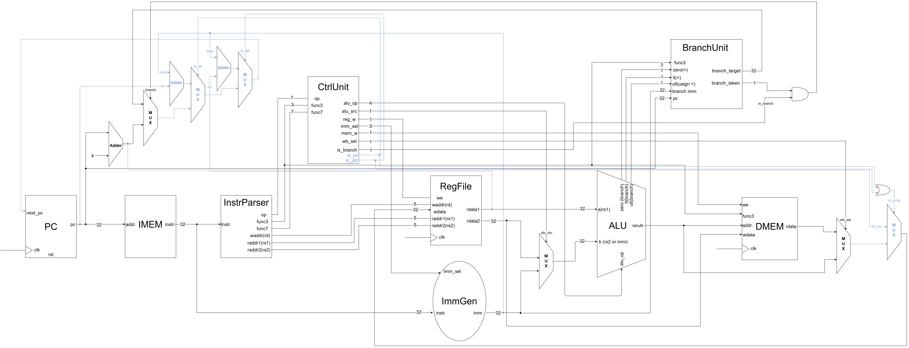

English | [繁體中文](README.zh-TW.md)

# R/I/S/B/J Datapath

This chapter extends the [R/I/S/B datapath](../08_risb_datapath/README.md) with JAL and JALR, expanding PC selection and write-back. Both jump and write the current instruction's `pc + 4` to `rd`. JAL uses the J-type format; JALR uses I-type.

- Circuit diagram



## JAL and JALR Instructions

JAL (Jump And Link) is an unconditional PC-relative jump with syntax `jal rd, offset`. It saves the address of the next instruction in `rd` and jumps to the current PC plus the offset, making it useful for function calls and direct jumps.

JALR (Jump And Link Register) is an unconditional register-based jump with syntax `jalr rd, imm(rs1)`. It also saves the return address, but calculates its target from `rs1 + imm` and then clears bit 0. It supports indirect function calls and returns.

| Instruction | Target PC | Data written to rd | Common use |
| --- | --- | --- | --- |
| `jal rd, offset` | `old PC + offset` | `old PC + 4` | Direct calls, PC-relative jumps |
| `jalr rd, imm(rs1)` | `(old rs1 + imm) & 0xFFFFFFFE` | `old PC + 4` | Indirect calls, returns |

Under common calling conventions, `x1` (`ra`) holds the return address. For example, `jal x1, offset` calls a function, which can return with `jalr x0, 0(x1)`; the latter is also the real instruction behind the `ret` pseudoinstruction. With `rd = x0`, the jump still occurs but the link is discarded. Neither instruction depends on the ALU's `zero` or ordering flags.

## New Logic and Data Flow

| New component | Location | Purpose |
| --- | --- | --- |
| Jump controls | `JAL` and `JALR` cases in `control.v` | Generate `is_jal` and `is_jalr`, select the immediate format, and enable register write-back |
| J-type immediate path | `immgen.v`, `imm_sel = 100` | Reassemble and sign-extend the JAL offset |
| PC selection extensions | PC section in `core_risbj.v` | Add `pc + imm` and `(rdata1 + imm) & ~1` |
| Link write-back | Write-back section in `core_risbj.v` | Select `pc + 4` for jump instructions |

Jumps do not require the Branch Unit's comparison condition. JAL adds the immediate to the current PC. JALR adds the immediate to `rs1`, then clears bit 0. The target and link are computed combinationally; PC and the destination register update together at the next rising edge.

## Control Unit Extensions

- New control signals

| Signal | Direction and width | Purpose |
| --- | --- | --- |
| `is_jal` | 1-bit output | Select JAL PC calculation and link write-back |
| `is_jalr` | 1-bit output | Select JALR PC calculation and link write-back |

Both signals default to zero at the start of `always @(*)` and are then set according to the opcode.

| Instruction | `opcode` | `reg_write` | `alu_src` | `imm_sel` | `mem_write` | `is_branch` | `is_jal` | `is_jalr` |
| --- | --- | --- | --- | --- | --- | --- | --- | --- |
| JAL | `1101111` | 1 | 0 | `100` (J) | 0 | 0 | 1 | 0 |
| JALR | `1100111` | 1 | 1 | `000` (I) | 0 | 0 | 0 | 1 |

Both select ADD for `alu_op`, but jump targets are currently calculated directly by additions inside the core. `wb_sel` remains a 1-bit signal selecting the normal ALU/load path; `is_jal || is_jalr` overrides it to select the link. The controller currently assigns `3'b010` to `wb_sel` for jumps, which truncates to zero; it is not a third write-back encoding.

## JAL and JALR Immediates

```verilog
// JAL: imm_sel = 3'b100
imm = {{11{instr[31]}}, instr[31], instr[19:12],
       instr[20], instr[30:21], 1'b0};

// JALR: imm_sel = 3'b000
imm = {{20{instr[31]}}, instr[31:20]};
```

JAL reconstructs its scattered immediate fields, appends a zero bit, and sign-extends to 32 bits. The range is -1048576 to 1048574 bytes in steps of 2 bytes. The immediate already includes the zero bit and needs no additional shift. JALR uses a signed 12-bit byte offset ranging from -2048 to 2047, without shifting.

## PC Selection

```verilog
always @(*) begin
    if (branch_taken & is_branch)
        next_pc = branch_target;
    else if (is_jal)
        next_pc = pc + imm;
    else if (is_jalr)
        next_pc = (rdata1 + imm) & 32'hfffffffe;
    else
        next_pc = pc + 32'd4;
end
```

JAL targets are relative to the current instruction PC, rather than `pc + 4`. At PC `0xE0`, `jal x15,+12` targets `0xEC` and writes link `0xE4`.

JALR first calculates `rs1 + imm`, then clears bit 0. With `x17 = 0x109` and offset 4, the target is `0x10C`. When `rd = rs1`, target calculation uses the old source value; the rising edge then writes the link to that register.

Clearing bit 0 does not guarantee 4-byte alignment. This IMEM uses `addr[31:2]`, all test targets are 4-byte aligned, and instruction-address misalignment exceptions are not implemented.

## Link Write-back

```verilog
if (is_jal || is_jalr)
    wb_data = pc + 32'd4;
else if (wb_sel)
    wb_data = mem_rdata;
else
    wb_data = alu_result;
```

| Instruction class | Write-back source |
| --- | --- |
| R/I ALU | `alu_result` |
| Load | `mem_rdata` |
| JAL/JALR | Current instruction's `pc + 4` |

# Code

- Test program

    `program.hex` retains the previous R/I, SW/LW, and six branch tests, followed by `//J` and an integration program summing 1 through 5. IMEM loads all instructions and initialization; the testbench only checks results.

    | Instruction PC | Test | Expected result |
    | --- | --- | --- |
    | `0xE0` | Forward JAL +12 | PC `0xEC`, `x15 = 0xE4` |
    | `0xEC` | Backward JAL -8 | PC `0xE4`, `x16 = 0xF0` |
    | `0xE4` | JAL with `rd = x0` | PC `0xF0`, x0 unchanged |
    | `0xF4` | JALR positive offset and bit 0 clearing | PC `0x10C`, `x18 = 0xF8` |
    | `0x10C` | JALR negative offset -5 | PC `0x104`, `x20 = 0x110` |
    | `0x108` | JALR return with `rd = x0` | PC `0x110`, `x19 = 7`, x0 unchanged |
    | `0x114` | JALR with `rd = rs1 = x21` | PC `0x120`, `x21 = 0x118` |
    | `0x120` | JALR with `rs1 = rd = x0` | PC `0x128`, x0 unchanged |
    | `0x128` | Completion marker | `x29 = 1`; `x31 = 0` confirms skipped failure markers |

- Sum 1 through 5

    | PC | Machine code | Instruction | Purpose |
    | --- | --- | --- | --- |
    | `0x12C` | `00100093` | `addi x1,x0,1` | Start counter at 1 |
    | `0x130` | `00000113` | `addi x2,x0,0` | Clear sum |
    | `0x134` | `00600193` | `addi x3,x0,6` | Set exclusive upper bound |
    | `0x138` | `0030D863` | `bge x1,x3,done` | +16 to `0x148` |
    | `0x13C` | `00110133` | `add x2,x2,x1` | Accumulate counter |
    | `0x140` | `00108093` | `addi x1,x1,1` | Increment counter |
    | `0x144` | `FF5FF06F` | `jal x0,loop` | -12 to `0x138` |
    | `0x148` | `00202023` | `sw x2,0(x0)` | Store sum 15 at DMEM byte addresses 0–3 |
    | `0x14C` | `0000006F` | `jal x0,0` | Remain at the current PC |

    `jal x0,0` jumps to itself; it is not a hardware halt, and the clock continues running.

- Testbench

    `tb_core_risbj.v` retains the R/I → S → B → J → SUM sections, using `repeat(...) @(posedge clk)`, `#1`, and `chk(...)`. The J section checks target PCs, links, and x0 before the sum program reinitializes x1–x3.

    The sum test waits 25 cycles: 3 initialization instructions, 5 iterations of 4 instructions, 1 exit BGE, and 1 SW. It expects `x1 = 6`, `x2 = 15`, and `x3 = 6`, and assembles `dmem0.mem[3:0]` in little-endian order to check that the stored word is 15. Another 2 cycles confirm PC remains at `0x14C` and x0 remains zero.

# Questions and Discussion

- None yet.
