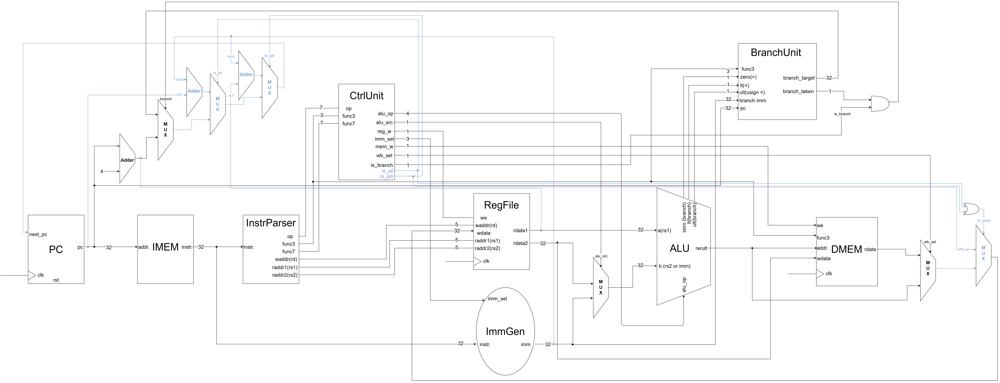

[English](README.md) | 繁體中文

# R/I/S/B/J Datapath

本章在 [R/I/S/B datapath](../08_risb_datapath/README.zh-TW.md) 上加入 JAL 與 JALR，擴充 PC 選擇與寫回路徑。兩者都會跳轉並將目前指令的 `pc + 4` 寫入 `rd`；JAL 使用 J-type 格式，JALR 則使用 I-type 格式。

- 電路圖



## 新增邏輯與資料流

| 新增部分 | 所在位置 | 功能 |
| --- | --- | --- |
| Jump 控制 | `control.v` 的 `JAL`、`JALR` 分支 | 產生 `is_jal`、`is_jalr`，選擇立即數格式並開啟暫存器寫回 |
| J-type 立即數路徑 | `immgen.v`，`imm_sel = 100` | 重組並符號延伸 JAL 位移 |
| PC 選擇擴充 | `core_risbj.v` 的 PC 區段 | 加入 `pc + imm` 與 `(rdata1 + imm) & ~1` |
| Link 寫回 | `core_risbj.v` 的 Write-back 區段 | Jump 指令選擇 `pc + 4` 作為寫回資料 |

Jump 不需要 Branch Unit 的比較條件。JAL 以目前 PC 加上立即數計算目標，JALR 以 `rs1` 加上立即數計算目標，再清除 bit 0。目標與 link 都在組合邏輯中計算；下一個上升緣同時更新 PC 與目的暫存器。

## JAL 與 JALR 指令介紹

JAL（Jump And Link）是 PC-relative 的無條件跳轉，語法為 `jal rd, offset`。它將下一條指令的位址保存在 `rd`，同時跳到目前 PC 加上位移的位置，常用於函式呼叫或直接跳轉。

JALR（Jump And Link Register）是以暫存器為基底的無條件跳轉，語法為 `jalr rd, imm(rs1)`。它同樣保存返回位址，但目標由 `rs1 + imm` 計算，再清除 bit 0，適合間接函式呼叫與返回。

| 指令 | 目標 PC | 寫入 rd 的資料 | 常見用途 |
| --- | --- | --- | --- |
| `jal rd, offset` | `舊 PC + offset` | `舊 PC + 4` | 直接呼叫、PC-relative 跳轉 |
| `jalr rd, imm(rs1)` | `(舊 rs1 + imm) & 0xFFFFFFFE` | `舊 PC + 4` | 間接呼叫、返回 |

依常見呼叫慣例，`x1`（`ra`）用來保存返回位址。例如 `jal x1, offset` 呼叫目標函式，再由 `jalr x0, 0(x1)` 返回；後者也是 `ret` 虛擬指令的實際指令。`rd = x0` 時不保存 link，但仍會跳轉。兩種指令都不依賴 ALU 的 `zero` 或大小比較旗標。

## Control Unit 新增部分

- 新增控制訊號

| 訊號 | 方向與寬度 | 功能 |
| --- | --- | --- |
| `is_jal` | 1-bit 輸出 | 選擇 JAL 的 PC 路徑與 link 寫回 |
| `is_jalr` | 1-bit 輸出 | 選擇 JALR 的 PC 路徑與 link 寫回 |

兩個訊號在 `always @(*)` 開頭預設為 0，再依 opcode 設定。

| 指令 | `opcode` | `reg_write` | `alu_src` | `imm_sel` | `mem_write` | `is_branch` | `is_jal` | `is_jalr` |
| --- | --- | --- | --- | --- | --- | --- | --- | --- |
| JAL | `1101111` | 1 | 0 | `100` (J) | 0 | 0 | 1 | 0 |
| JALR | `1100111` | 1 | 1 | `000` (I) | 0 | 0 | 0 | 1 |

兩者的 `alu_op` 都設為 ADD，但目前 jump 目標由 core 內的加法運算直接產生。`wb_sel` 仍是 1-bit 訊號，僅選擇一般 ALU／load 寫回路徑；jump 透過 `is_jal || is_jalr` 優先選擇 link。控制單元目前將 jump 的 `wb_sel` 寫成 `3'b010`，實際截斷為 0，不是第三種寫回編碼。

## JAL 與 JALR 的立即數

```verilog
// JAL: imm_sel = 3'b100
imm = {{11{instr[31]}}, instr[31], instr[19:12],
       instr[20], instr[30:21], 1'b0};

// JALR: imm_sel = 3'b000
imm = {{20{instr[31]}}, instr[31:20]};
```

JAL 位移由分散欄位重組，最低位補 0，再符號延伸至 32 bits，範圍為 -1048576～1048574 bytes，單位為 2 bytes。立即數已包含最低位 0，不需再次左移。JALR 使用 12-bit signed byte 位移，範圍為 -2048～2047，不做左移。

## PC 選擇

```verilog
always @(*) begin
    if (branch_taken & is_branch)
        next_pc = branch_target;
    else if (is_jal)
        next_pc = pc + imm;
    else if (is_jalr)
        next_pc = (rdata1 + imm) & 32'hfffffffe;
    else
        next_pc = pc + 32'd4;
end
```

JAL 的目標以目前指令 PC 為基準，不是 `pc + 4`。例如 PC `0xE0` 的 `jal x15,+12` 跳到 `0xEC`，link 為 `0xE4`。

JALR 先計算 `rs1 + imm`，再清除結果的 bit 0。例如 `x17 = 0x109`、位移為 4 時，目標為 `0x10C`。若 `rd = rs1`，目標使用寫回前的來源值；上升緣才將 link 寫入該暫存器。

清除 bit 0 不代表保證 4-byte 對齊。此實作 IMEM 使用 `addr[31:2]`，測試都選擇 4-byte 對齊目標，目前沒有指令位址未對齊的例外處理。

## Link 寫回

```verilog
if (is_jal || is_jalr)
    wb_data = pc + 32'd4;
else if (wb_sel)
    wb_data = mem_rdata;
else
    wb_data = alu_result;
```

| 指令類別 | 寫回來源 |
| --- | --- |
| R/I ALU | `alu_result` |
| Load | `mem_rdata` |
| JAL／JALR | 目前指令的 `pc + 4` |


# Code

- 測試程式

    `program.hex` 保留前章的 R/I、SW/LW 與六種分支測試，接續 `//J`，最後執行加總 1～5 的整合程式。指令與初始化均由 IMEM 載入，testbench 只檢查結果。

    | 指令 PC | 測試 | 預期結果 |
    | --- | --- | --- |
    | `0xE0` | JAL 向前 +12 | PC `0xEC`，`x15 = 0xE4` |
    | `0xEC` | JAL 向後 -8 | PC `0xE4`，`x16 = 0xF0` |
    | `0xE4` | JAL，`rd = x0` | PC `0xF0`，x0 不變 |
    | `0xF4` | JALR 正位移與清除 bit 0 | PC `0x10C`，`x18 = 0xF8` |
    | `0x10C` | JALR 負位移 -5 | PC `0x104`，`x20 = 0x110` |
    | `0x108` | JALR 返回，`rd = x0` | PC `0x110`，`x19 = 7`，x0 不變 |
    | `0x114` | JALR，`rd = rs1 = x21` | PC `0x120`，`x21 = 0x118` |
    | `0x120` | JALR，`rs1 = rd = x0` | PC `0x128`，x0 不變 |
    | `0x128` | 完成標記 | `x29 = 1`；`x31 = 0` 表示未執行應跳過的標記 |

- 加總 1～5

    | PC | 機器碼 | 指令 | 功能 |
    | --- | --- | --- | --- |
    | `0x12C` | `00100093` | `addi x1,x0,1` | 計數器從 1 開始 |
    | `0x130` | `00000113` | `addi x2,x0,0` | 清除總和 |
    | `0x134` | `00600193` | `addi x3,x0,6` | 設定結束界線 |
    | `0x138` | `0030D863` | `bge x1,x3,done` | +16，跳到 `0x148` |
    | `0x13C` | `00110133` | `add x2,x2,x1` | 累加目前計數器 |
    | `0x140` | `00108093` | `addi x1,x1,1` | 計數器加一 |
    | `0x144` | `FF5FF06F` | `jal x0,loop` | -12，跳回 `0x138` |
    | `0x148` | `00202023` | `sw x2,0(x0)` | 將總和 15 寫入 DMEM byte 位址 0～3 |
    | `0x14C` | `0000006F` | `jal x0,0` | 停在目前 PC |

    `jal x0,0` 是跳回自身的指令，不是硬體 halt；clock 仍持續運作。

- Testbench

    `tb_core_risbj.v` 維持 R/I → S → B → J → SUM 的分段格式，使用 `repeat(...) @(posedge clk)`、`#1` 與 `chk(...)`。J 段依執行路徑檢查目標 PC、link 與 x0，之後才重新初始化 x1～x3 執行加總。

    加總共等待 25 cycles：3 次初始化、5 輪各 4 條指令、1 次離開迴圈的 BGE、1 次 SW。預期 `x1 = 6`、`x2 = 15`、`x3 = 6`，並以 little-endian 順序組合 `dmem0.mem[3:0]` 檢查 word 為 15。再執行 2 cycles，確認 PC 保持 `0x14C` 且 x0 為 0。


# 問題與討論

- 暫無
